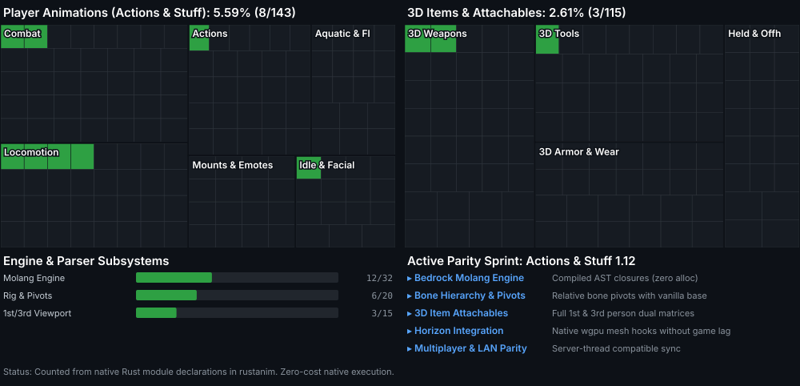

# rustanim

> High-performance native Rust Bedrock `.mcpack` animation and 3D attachable engine for [Horizon](https://github.com/horizon-rust/horizon).


Bringing full-fidelity Bedrock animation rigs (such as **Actions & Stuff 1.12**) to Horizon with zero runtime overhead, exact relative joint pivots, and dual first-person & third-person 3D attachables.

## Status

[](PROGRESS.md) [](PROGRESS.md) [](PROGRESS.md)

[](PROGRESS.md)

[**Full Progress Breakdown & Parity Checklist (PROGRESS.md)**](PROGRESS.md)

<sub>* Status is computed from native Rust modules and Bedrock schema declarations. Total animation clips: 143+ mapped states across locomotion, combat, actions, and swimming; 112+ 3D attachables.</sub>

---

## Key Architecture

### 1. Relative Pivot Rigging (No Limb Stretching or Hip Collapse)
Java Minecraft humanoids anchor legs at `y: 12.0` and shoulders at `y: 22.0`. Bedrock models often define bones with arbitrary origin offsets. `rustanim` maps Bedrock bone animations onto vanilla base joints using **relative delta transforms**, preventing joint detachment, collapsed hip bones, and broken head-look tracking.

### 2. Dual-Perspective 3D Attachables (1st Person & 3rd Person)
While existing community experiments only display basic 3rd-person models, `rustanim` implements dual viewport transformations:
- **1st Person**: Exact weapon swings, bow charge depth, shield block angle, and FOV clipping avoidance.
- **3rd Person**: Dynamic mount points for sheathed weapons (back and hip mounts), dual wielding, and armor attachments.

### 3. Native Molang Engine (Zero-Allocation Evaluation)
Bedrock animations heavily rely on Molang queries (`query.anim_time`, `math.sin`, `query.ground_speed`). `rustanim` includes a native Molang lexer and AST evaluator that resolves animation curves in sub-microseconds without runtime heap allocations.

### 4. Zero-Copy Horizon Integration
Engineered to bind directly into Horizon's `wgpu` vertex pipeline and server-thread animation ticking, keeping frame rates at maximum refresh rates without GC pauses.

---

## Roadmap

- [x] Initial repository structure & AnyPS5-style progress tracking
- [ ] Molang AST parser & query state bindings
- [ ] Bedrock `.mcpack` animation format deserializer (1.8.0 / 1.10.0 JSON)
- [ ] Humanoid relative pivot rig & Catmull-Rom spline interpolation
- [ ] 3D Attachable geometry parser & 1st-person viewmodel transforms
- [ ] Horizon client runtime bridge

---

## Updating Progress

Progress map and badges are automatically generated:

```bash
python3 tools/progress.py
```

This updates `progress.svg`, `badge-*.svg`, and `PROGRESS.md`.
